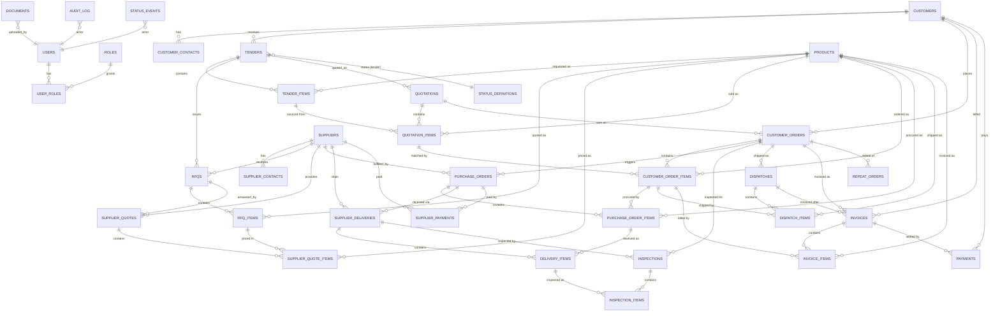

# DATABASE-ERD — Ramprasad Defence: Defence Contract & Supply Management System

> **2026-10-07 — IMPLEMENTED. THIS DOCUMENT IS NOW SUPERSEDED.**
> The schema has been implemented as versioned SQL in `supabase/migrations/` and documented
> table-by-table in `docs/DATABASE.md`. Those two are the source of truth. This ERD remains as
> the original design record; the implemented schema differs in naming and adds tables. Key
> differences to be aware of when reading this file:
> - `suppliers` → **`oems`** (with `oem_contacts`, `oem_products`, `oem_price_history`).
> - Added: `opportunities`, `requirements`, `compliance_items`, `quotation_approvals`,
>   `purchase_requests` (+ items), `invoice_items`, `material_receipt_items`, `dispatch_items`,
>   `warranties`, `tasks`, `notifications`, and `user_roles`.
> - `status_events` was not implemented as a separate table; every change is captured in
>   `audit_logs` (before/after jsonb per row), and header totals / quantities are maintained by
>   triggers instead.
> - The implemented schema has **41 tables** (see `docs/DATABASE.md` §2).

**Status of this file: HISTORICAL DESIGN RECORD.** The implemented schema lives in
`supabase/migrations/`; the data dictionary lives in `docs/DATABASE.md`.

**Inputs:** `PRD.md` (workflow §5, roles §3, security §6), `TECH-STACK.md` (Postgres, RLS).

**Conventions used throughout**
- Primary keys: `id uuid default gen_random_uuid()`.
- Every table has `created_at timestamptz default now()` and `updated_at timestamptz`.
- Actor columns (`created_by`, `approved_by`, …) reference our own `users.id` (not the auth
  provider id) so history survives a provider change.
- **Money:** `numeric(14,2)`, currency stored beside it. Never `float`.
- **Quantities:** `numeric(14,3)` where fractional units are possible.
- **Dates are `date`; timestamps are `timestamptz` in UTC.**
- **Soft delete:** `deleted_at timestamptz` on business tables; hard delete only for drafts.
- **Status** is stored as a `text` code that references a lookup table
  (`status_definitions`) rather than a hard-coded enum, so workflows can be re-labelled
  without a migration.
- **Every status change** writes a row to `status_events`; **every change** writes to
  `audit_log` (via trigger).

---

## 1. Entity-relationship diagram (core chain)

> `DOCUMENTS` is polymorphic: it links to any entity via `(entity_type, entity_id)`, so it is
> drawn as one box rather than one edge per table. Every business record can own documents.

---

## 2. Table catalog

### 2.1 Identity and access

**`users`** — our internal mirror of the authenticated person.
| column | type | notes |
|---|---|---|
| id | uuid PK | referenced by every actor column |
| auth_user_id | uuid unique | the Supabase `auth.users.id` |
| full_name | text not null | |
| email | text not null unique | |
| phone | text | |
| is_active | boolean default true | |
| mfa_enabled | boolean default false | |
| last_login_at | timestamptz | |

**`roles`** — the 9 roles from `PRD.md` §3 (`code`, `name`, `description`).

**`user_roles`** — `user_id` ↔ `role_code` (unique together). A user may hold more than one
role; effective permissions are the union, except where segregation-of-duties rules forbid it.

**`status_definitions`** — `entity_type`, `code`, `label`, `sort_order`, `is_terminal`.
Makes workflow statuses data, not code.

### 2.2 Masters

**`customers`** — defence buyers (MoD, DPSUs, armed forces units, paramilitary).
`code, name, customer_type, address, city, state, pincode, country, gstin, pan, website,
is_active` (+ soft delete).

**`customer_contacts`** — `customer_id → customers`, `name, designation, email, phone,
is_primary`.

**`suppliers`** (OEMs) — `code, name, supplier_type, address, country, gstin, pan,
payment_terms, is_active`.

**`supplier_contacts`** — same shape as customer contacts.

**`products`** (item master) — `code, name, description, category, unit, hsn_code,
manufacturer, part_number, is_active`. Used as the natural key for tender lines, RFQs, POs
and dispatches.

### 2.3 Tender / enquiry domain (S1–S5)

**`tenders`** — `tender_no, customer_id → customers, source, title, description, received_date,
bid_due_date, corrigendum_date, emd_amount numeric(14,2), emd_exempt boolean, bid_validity_date,
currency, status (→ status_definitions), owner_user_id → users, priority, created_by`.

**`tender_items`** — `tender_id → tenders, line_no, product_id → products (nullable),
description, specification text, quantity numeric(14,3), unit, feasibility
(feasible/clarification/not_feasible), technical_notes, assigned_to → users`.

**`rfqs`** — request for quotation sent to one OEM for a tender.
`rfq_no, tender_id → tenders, supplier_id → suppliers, sent_date, due_date, status, notes,
created_by`.

**`rfq_items`** — `rfq_id → rfqs, tender_item_id → tender_items, product_id → products,
description, quantity, unit`.

**`supplier_quotes`** — a priced response from an OEM.
`rfq_id → rfqs, supplier_id → suppliers, quote_ref, quote_date, currency, validity_date,
lead_time_days, warranty, incoterms, taxes_note, status, created_by`.

**`supplier_quote_items`** — `supplier_quote_id → supplier_quotes, rfq_item_id → rfq_items,
product_id → products, description, quantity, unit_price numeric(14,2), discount, tax_pct,
line_total numeric(14,2)`.

**`quotations`** — versioned quote to the customer. Never overwrite a submitted revision.
`quotation_no, version int, tender_id → tenders, customer_id → customers, quote_date,
validity_date, currency, subtotal numeric(14,2), tax_total, grand_total,
status (draft/pending_approval/approved/submitted/revised/won/lost), approved_by → users,
approved_at, submitted_at, created_by`. Unique on `(quotation_no, version)`.

**`quotation_items`** — `quotation_id → quotations, line_no, product_id → products,
tender_item_id → tender_items (nullable), source_supplier_quote_item_id →
supplier_quote_items (nullable), description, quantity, unit, unit_price, tax_pct, line_total`.

**`customer_orders`** — the customer PO.
`po_no, po_date, customer_id → customers, quotation_id → quotations (nullable), value
numeric(14,2), currency, delivery_terms, payment_terms, consignee_name, consignee_address,
status, created_by`.

**`customer_order_items`** — `customer_order_id → customer_orders, line_no, product_id,
quotation_item_id → quotation_items (nullable), description, quantity, unit, unit_price,
tax_pct, line_total`.

### 2.4 Procurement and fulfilment domain (S6–S9)

**`purchase_orders`** — PO to an OEM.
`po_no, po_date, supplier_id → suppliers, customer_order_id → customer_orders, currency,
value numeric(14,2), expected_delivery_date, terms, status, approved_by → users, created_by`.

**`purchase_order_items`** — `purchase_order_id → purchase_orders, line_no, product_id,
customer_order_item_id → customer_order_items (nullable), description, quantity, unit,
unit_price, tax_pct, line_total, received_qty default 0`.

**`supplier_deliveries`** (goods receipt note) — `grn_no, purchase_order_id → purchase_orders,
supplier_id → suppliers, docket_no, dispatch_date, expected_date, received_date,
received_by → users, status, notes`.

**`delivery_items`** — `supplier_delivery_id → supplier_deliveries, purchase_order_item_id →
purchase_order_items, product_id, qty_received, qty_accepted, qty_rejected, remarks`.

**`inspections`** (PDI / QA) — `inspection_no, inspection_type (incoming/in_process/final/pdi/
third_party), supplier_delivery_id → supplier_deliveries (nullable), customer_order_id →
customer_orders, inspection_date, inspector_user_id → users, result (pass/fail/conditional),
certificate_no, third_party_agency, notes, created_by`.

**`inspection_items`** — `inspection_id → inspections, delivery_item_id → delivery_items,
product_id, qty_inspected, qty_passed, qty_failed, defect_notes`.

**`dispatches`** — `dispatch_no, customer_order_id → customer_orders, customer_id → customers,
dispatch_date, carrier, tracking_no, eway_bill_no, consignee_name, consignee_address, status,
delivery_confirmed_date, pod_document_id → documents (nullable), created_by`.

**`dispatch_items`** — `dispatch_id → dispatches, customer_order_item_id →
customer_order_items, product_id, quantity, packing_details`.

### 2.5 Finance domain (S10–S11)

**`invoices`** — `invoice_no, invoice_date, customer_id → customers, customer_order_id →
customer_orders, dispatch_id → dispatches (nullable), currency, subtotal, tax_total,
grand_total, due_date, status (draft/issued/part_paid/paid/void), created_by`. A paid invoice
cannot be edited.

**`invoice_items`** — `invoice_id → invoices, line_no, product_id, description, quantity, unit,
unit_price, tax_pct, line_total`.

**`payments`** (customer receipts) — `payment_no, invoice_id → invoices, customer_id →
customers, payment_date, amount numeric(14,2), mode, reference, notes, recorded_by → users`.
The invoice's status is derived from the sum of its payments, never typed in by hand.

**`supplier_payments`** (payables) — `purchase_order_id → purchase_orders, supplier_id →
suppliers, payment_type (advance/partial/final), payment_date, amount, mode, reference, notes,
recorded_by`.

**`repeat_orders`** — `new_customer_order_id → customer_orders, parent_customer_order_id →
customer_orders, reason, created_by`. Marks an order as a repeat/renewal of an earlier one.

### 2.6 Cross-cutting

**`documents`** — `entity_type, entity_id, doc_type, file_name, storage_path, mime_type,
size_bytes, version, classification (unclassified/internal/controlled/itar_ear),
uploaded_by → users, uploaded_at, notes`.

**`status_events`** — `entity_type, entity_id, from_status, to_status, actor_user_id → users,
at, notes`. Append-only.

**`audit_log`** — `actor_user_id → users, action (insert/update/delete/approve/submit/…),
entity_type, entity_id, before jsonb, after jsonb, at, ip_address`. Append-only, written by
trigger.

**`tasks`** (optional) — `entity_type, entity_id, title, assigned_to → users, due_date, status,
completed_at`. Backs follow-ups and n8n reminders.

**`settings`** — key/value config: company profile, GST defaults, approval threshold,
alert lead times, business timezone.

---

## 3. Relationship summary (cardinality)

| Parent | Relationship | Child | Rule |
|---|---|---|---|
| customers | 1 → N | tenders | a customer raises many tenders |
| customers | 1 → N | customer_orders | |
| tenders | 1 → N | tender_items | |
| tenders | 1 → N | rfqs | one RFQ per supplier |
| tenders | 1 → N | quotations | versioned revisions |
| suppliers | 1 → N | supplier_quotes | |
| rfqs | 1 → N | supplier_quotes | usually 1, occasionally revisions |
| quotations | 1 → N | quotation_items | |
| quotations | 1 → N | customer_orders | normally 1 (won quote → 1 PO) |
| customer_orders | 1 → N | purchase_orders | one customer order can need several OEM POs |
| customer_orders | 1 → N | dispatches | partial dispatches allowed |
| purchase_orders | 1 → N | supplier_deliveries | partial receipts allowed |
| supplier_deliveries | 1 → N | inspections | |
| customer_orders | 1 → N | invoices | milestone/partial invoicing allowed |
| invoices | 1 → N | payments | part payments allowed |
| documents | N → 1 | (any entity) | polymorphic |

**Key integrity rules to enforce (constraints/triggers):**
1. `quotation_items.quantity`, `purchase_order_items.quantity`, `delivery_items.qty_received`
   and `dispatch_items.quantity` must be `> 0`.
2. `supplier_quotes.validity_date >= quote_date`; `tenders.bid_due_date >= received_date`.
3. `delivery_items.qty_received` against a PO line may not exceed the ordered quantity unless
   an explicit over-delivery flag is set.
4. An inspection `result = 'pass'` is required before any `dispatch_items` row for the same
   order line (enforced in workflow/trigger).
5. `invoices.grand_total` must equal the sum of its `invoice_items.line_total` (trigger).
6. `invoices.status` cannot be `paid` unless `sum(payments.amount) >= grand_total`.
7. `customer_order_items.quotation_item_id`, when set, must belong to the linked quotation.

---

## 4. Indexes (the ones that matter)

- `tenders (bid_due_date)`, `tenders (status)`, `tenders (customer_id)`.
- `rfqs (due_date, status)`, `supplier_quotes (rfq_id)`.
- `quotations (tender_id, version)`, `quotations (status)`.
- `customer_orders (customer_id, po_date)`, `(status)`.
- `purchase_orders (supplier_id, expected_delivery_date)`, `(status)`.
- `supplier_deliveries (purchase_order_id)`, `(expected_date)`.
- `inspections (result)`, `(customer_order_id)`.
- `dispatches (status, dispatch_date)`.
- `invoices (customer_id, status, due_date)` for ageing.
- `payments (invoice_id)`, `supplier_payments (purchase_order_id)`.
- `documents (entity_type, entity_id)`.
- `audit_log (entity_type, entity_id, at)`, `status_events (entity_type, entity_id, at)`.
- Unique: `customers.code`, `suppliers.code`, `products.code`, `tenders.tender_no`,
  `(quotations.quotation_no, version)`, `customer_orders.po_no`, `invoices.invoice_no`.

---

## 5. Row Level Security approach (the security backbone)

RLS is enabled on **every** table in `public`. Policies are keyed to `auth.uid()` and the
user's roles from `user_roles`.

- **Default deny:** with RLS on and no matching policy, a request returns nothing.
- **Read:** a user sees a row only if their role grants read for that domain
  (matrix in `PRD.md` §3.1). `viewer` is read-only everywhere.
- **Write:** enforced by role; e.g. only `procurement` inserts `purchase_orders`, only `stores`
  inserts `supplier_deliveries`, only `qa` sets `inspections.result`, only `accounts` inserts
  `payments`.
- **Segregation of duties:** a trigger rejects a `payments.recorded_by` equal to the
  `invoices.created_by`; a trigger rejects `supplier_deliveries.received_by` equal to the
  related `purchase_orders.created_by`.
- **Documents:** the Storage bucket policy grants a signed URL only when the requester passes
  the RLS check on the linked `documents` row; `controlled`/`itar_ear` rows are limited to
  `admin`, `management`, `technical`, `qa`.
- **Audit tables:** `audit_log` and `status_events` are append-only — no `update`/`delete`
  policy exists for normal roles.
- **The test that matters** (`AGENTS.md` §3): a signed-in `accounts` user requesting a
  `purchase_orders` row directly by id must be refused by the database, not the screen.

---

## 6. Money and audit conventions (applied everywhere)

- All totals (`subtotal`, `tax_total`, `grand_total`, `line_total`) are stored **and**
  recomputed by trigger from the line items; the stored value must equal the recomputed value
  or the write fails.
- No derived money is ever computed in the browser or by n8n.
- `audit_log` guarantees "who changed what, when, and from what".

---

## 7. Open schema questions tied to `PRD.md` §10

| # | Question | Affects |
|---|---|---|
| Q1 | Residency / region (A4) | Where the database lives; blocking. |
| Q2 | ITAR/EAR data stored? (R2) | Whether `classification` restricts or excludes rows. |
| Q3 | Multi-currency and GST rules (A6) | Whether FX rate columns are needed on PO/quote/invoice. |
| Q4 | Approval threshold (A7) | `settings` value; quotation approval trigger. |
| Q5 | Inspection authorities | Values in `inspections.inspection_type` / `third_party_agency`. |
| Q6 | Repeat-order definition | Shape of `repeat_orders`. |
| Q7 | Full stock ledger now or Phase 2? | Whether an `inventory` table is added to MVP. |

---

## Decisions log

- 2026-10-07 — ERD and table catalog drafted as PLAN ONLY. 30 tables proposed across identity,
  masters, tender, procurement, finance and cross-cutting domains. No table created. Awaiting
  owner answers to PRD §10 and approval before writing migrations.
